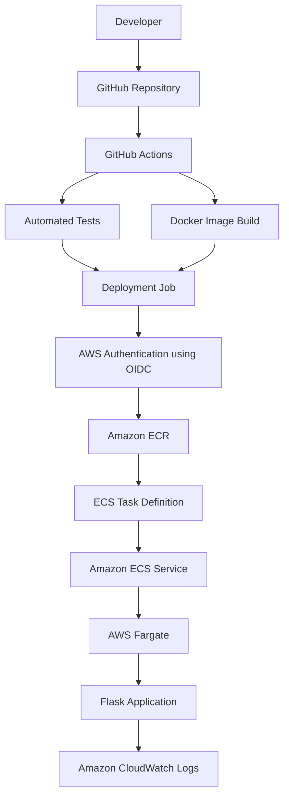
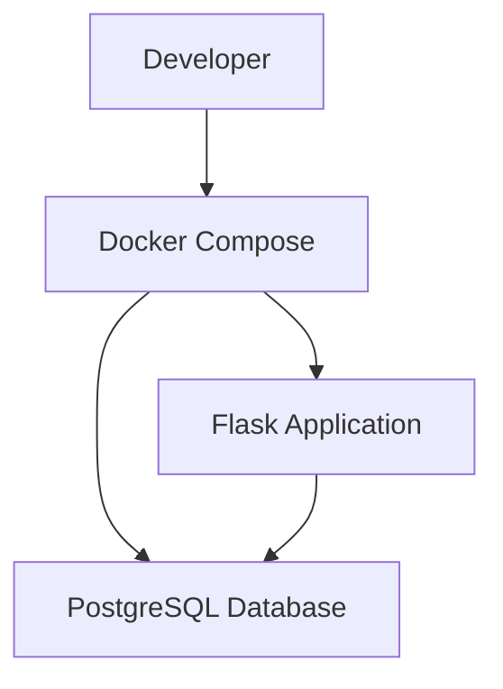
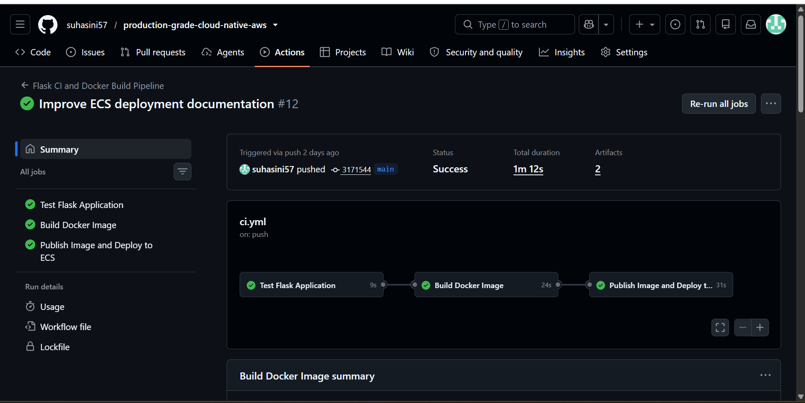
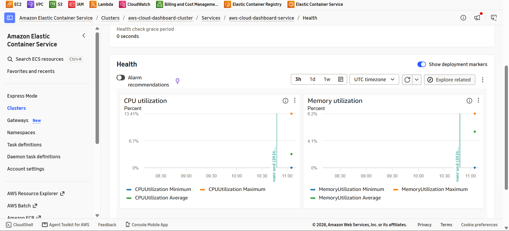
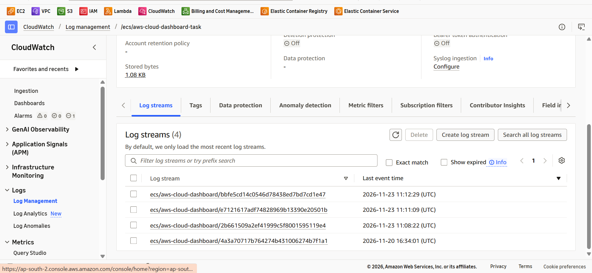
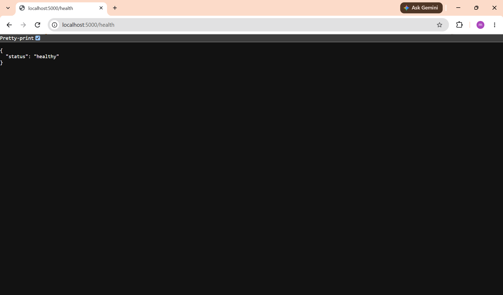

# Cloud-Native Flask Application on AWS

A cloud-native application built with Python and Flask, containerized using Docker, and deployed to Amazon ECS with AWS Fargate. This project demonstrates automated testing, container image publishing, and deployment through GitHub Actions using secure AWS OIDC authentication.

**Project status:** Core CI/CD pipeline and ECS/Fargate deployment successfully tested. The ECS service is currently scaled to zero tasks between tests to control costs.

**GitHub Repository:** [production-grade-cloud-native-aws](https://github.com/suhasini57/production-grade-cloud-native-aws)

---

## 1. Project Overview

This project demonstrates how to build, containerize, test, and deploy a cloud-native application using AWS services and modern DevOps practices.

The application provides dashboard endpoints and integrates with PostgreSQL for deployment-related data. Docker Compose is used for local application and database integration, while AWS ECS with Fargate is used for cloud deployment.

A GitHub Actions pipeline automates application testing, Docker image creation, publishing to Amazon ECR, and ECS task definition deployment.

## 2. Architecture

### Implemented CI/CD and AWS deployment flow



### Local development architecture



## 3. Technology Stack

| Category | Technologies |
|---|---|
| Programming Language | Python |
| Backend Framework | Flask |
| Database | PostgreSQL |
| Database Integration | SQLAlchemy |
| Containerization | Docker |
| Local Environment | Docker Compose |
| Version Control | Git and GitHub |
| CI/CD | GitHub Actions |
| AWS Authentication | IAM and OIDC |
| Container Registry | Amazon ECR |
| Container Orchestration | Amazon ECS |
| Compute | AWS Fargate |
| Monitoring and Logging | Amazon CloudWatch |

## 4. Application Features

- Flask-based dashboard application.
- `/` – Dashboard home endpoint.
- `/health` – Application health-check endpoint.
- `/deployments` – Deployment data endpoint backed by PostgreSQL.
- Automated application tests using pytest.
- Docker-based application packaging.
- Local PostgreSQL integration using Docker Compose.
- Automated Docker image publishing to Amazon ECR.
- Automated ECS task definition registration and service update.
- Application logs delivered to Amazon CloudWatch.

## 5. CI/CD Pipeline

GitHub Actions automates the application delivery process.

### Pipeline stages

1. **Source control:** Code changes are pushed to the GitHub repository.
2. **Automated testing:** GitHub Actions installs dependencies and runs application tests using pytest.
3. **Docker build:** The application is packaged into a Docker image.
4. **AWS authentication:** GitHub Actions assumes an AWS IAM role using OpenID Connect (OIDC).
5. **Image publishing:** The Docker image is tagged and pushed to Amazon ECR.
6. **Task definition update:** The ECS task definition is rendered with the newly built image and registered.
7. **Deployment:** The ECS service is updated using the new task definition.

The deployment process runs after the required testing and image-building stages complete successfully.

### Security approach

- GitHub OIDC is used instead of storing long-lived AWS access keys in GitHub repository secrets.
- IAM permissions are configured for the GitHub Actions deployment role.
- AWS access is provided through temporary role credentials.

## 6. AWS Deployment Details

| Component | Configuration |
|---|---|
| AWS Region | Asia Pacific (Hyderabad) – `ap-south-2` |
| Container Registry | Amazon ECR |
| Container Orchestration | Amazon ECS |
| Compute Engine | AWS Fargate |
| Task CPU | 0.25 vCPU |
| Task Memory | 512 MB |
| Application Port | 5000 |
| Logging | Amazon CloudWatch |

## Deployment verification

### GitHub Actions – Successful CI/CD Pipeline



### Amazon ECS – Service Deployment



### Amazon CloudWatch – Application Logs



### Application Health Check – Local Docker Compose



**Availability note:** The ECS service is not continuously running while its desired count is zero. Running Fargate tasks can incur charges.

## 7. Repository Structure

```text
production-grade-cloud-native-aws/
│
├── .github/
│   └── workflows/
│       └── ci.yml
│
├── app/
│   ├── tests/
│   │   └── test_app.py
│   ├── app.py
│   ├── Dockerfile
│   └── requirements.txt
│
├── docs/
│   ├── architecture.md
│   ├── cloudwatch.md
│   ├── docker.md
│   ├── ecr.md
│   ├── ecs.md
│   └── ecs-deployment.md
│
├── ecs/
│   └── task-definition.json
│
├── architecture/
├── compose.yaml
├── .gitignore
└── README.md
```

## 8. Run Locally

### Prerequisites

- Git
- Docker Desktop
- Docker Compose

### Step 1: Clone the repository

```bash
git clone https://github.com/suhasini57/production-grade-cloud-native-aws.git
cd production-grade-cloud-native-aws
```

### Step 2: Configure environment variables

Create a local `.env` file containing the environment variables required by the application and `compose.yaml`.

Do not commit `.env` or store database passwords and other credentials in source code.

### Step 3: Build and start the application

```bash
docker compose up --build -d
```

### Step 4: Verify the application

Open the dashboard:

```text
http://localhost:5000/
```

Test the health endpoint:

```bash
curl http://localhost:5000/health
```

Expected response:

```json
{
  "status": "healthy"
}
```

### Step 5: Stop the local containers

```bash
docker compose down
```

This stops and removes the Compose containers and network without explicitly requesting deletion of the database volume.

**Important:** Do not use `docker compose down -v` if you want to preserve your local PostgreSQL data.

## 9. Project Documentation

Detailed implementation notes are available in the `docs/` directory.

- [Architecture](docs/architecture.md)
- [Docker Implementation](docs/docker.md)
- [Amazon ECR](docs/ecr.md)
- [Amazon ECS](docs/ecs.md)
- [CloudWatch Logging](docs/cloudwatch.md)
- [ECS Deployment and CI/CD](docs/ecs-deployment.md)

## 10. Security and Cost Management

### Security practices

- Use IAM roles and least-privilege permissions.
- Use GitHub OIDC for temporary AWS credentials.
- Keep `.env` and sensitive credentials out of version control.
- Restrict inbound security-group access to required sources and ports.
- Avoid exposing AWS credentials in application code or GitHub commits.

### Cost management

- Scale down ECS tasks when not testing.
- Monitor ECR image storage.
- Review CloudWatch log retention settings.
- Check AWS resources regularly for ongoing charges.
- Remember that stopping ECS tasks does not automatically eliminate every AWS cost.

## 11. Future Enhancements – Planned

The following improvements are part of the project roadmap and are not yet implemented:

- Replace Flask's development server with Gunicorn.
- Infrastructure as Code using Terraform.
- Application Load Balancer integration.
- Amazon RDS for managed PostgreSQL.
- AWS Secrets Manager for secure credential management.
- Route 53 and CloudFront integration.
- AWS WAF for application protection.
- Kubernetes fundamentals and deployment using Amazon EKS.

## 12. Learning Outcomes

Through this project, I am developing practical experience in:

- Building and testing Python-based web applications.
- Containerizing applications using Docker.
- Managing application and database containers using Docker Compose.
- Publishing container images to Amazon ECR.
- Deploying containerized workloads using ECS and Fargate.
- Building CI/CD pipelines using GitHub Actions.
- Configuring secure AWS access through IAM and OIDC.
- Managing ECS task definitions and services.
- Monitoring application execution through CloudWatch logs.
- Troubleshooting application deployment and AWS configuration issues.
